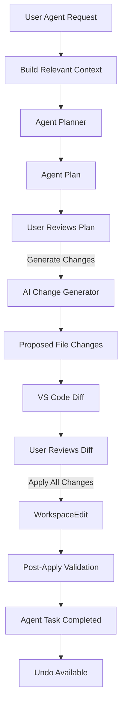
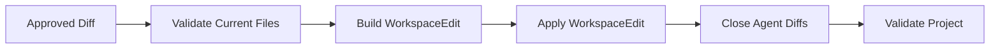
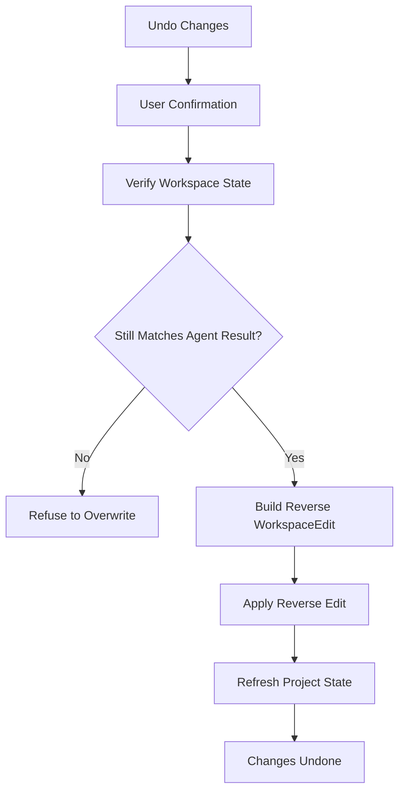
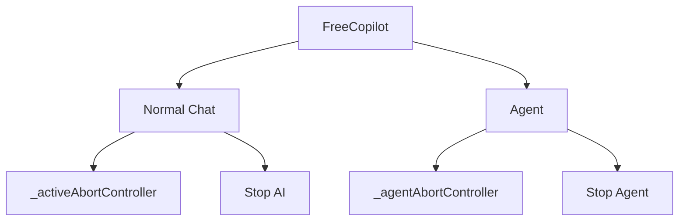
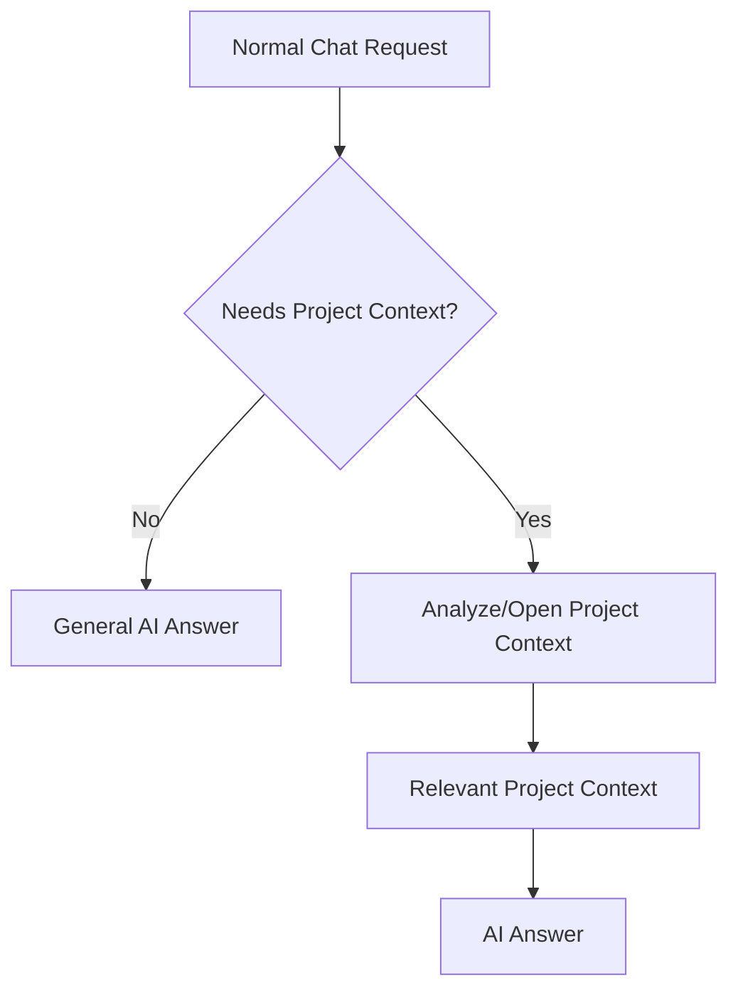
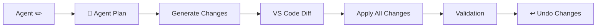
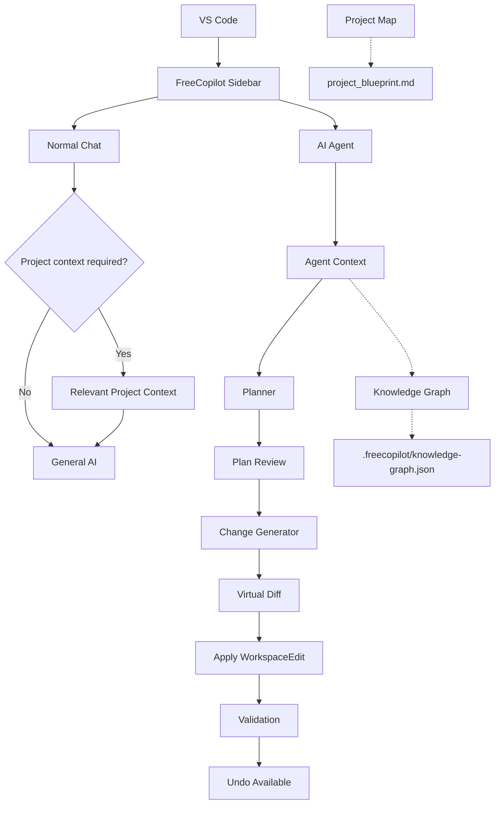
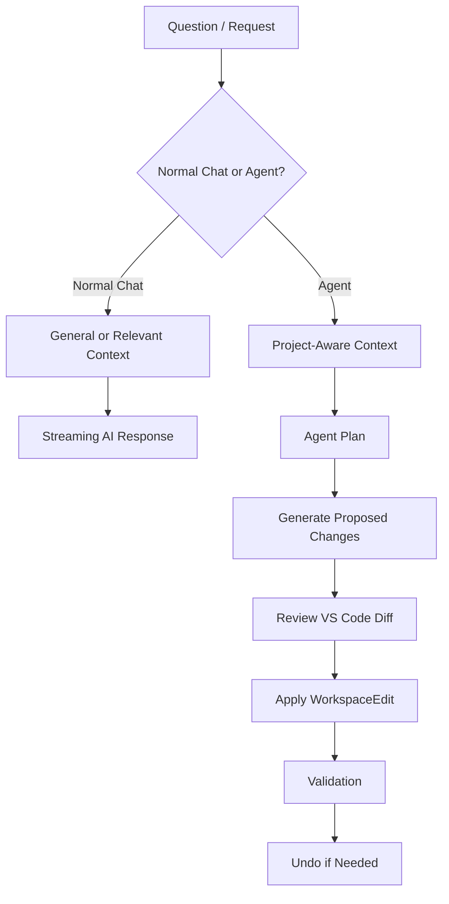

# 🚀 Free AI Copilot for VS Code

A lightweight, private, and customizable AI code assistant sidebar. FreeCopilot connects directly to locally running AI models such as Ollama, giving you direct control over your development environment and project context.

## 📚 Contents

- [Core Features](#-core-features)
- [Project Map & Knowledge Graph](#-project-map--knowledge-graph)
- [AI Coding Agent](#-ai-coding-agent)
  - [Agent Workflow](#agent-workflow)
  - [Plan Review](#plan-review)
  - [Change Generation & Diff Review](#change-generation--diff-review)
  - [Apply Changes](#apply-changes)
  - [Post-Apply Validation](#post-apply-validation)
  - [Undo Agent Changes](#undo-agent-changes)
  - [Agent Interruption & Concurrency](#agent-interruption--concurrency)
  - [Delete Target Resolution](#delete-target-resolution)
- [Normal Chat Context](#-normal-chat-context)
- [Requirements & Setup](#-requirements--setup)
  - [Local Ollama Integration](#1-local-ollama-integration-default)
  - [Multi-Modal Assets](#2-multi-modal-assets-gemini--free-api)
  - [Package the Extension](#3-package-the-extension)
- [How To Use](#-how-to-use)
- [Example Agent Workflow](#-example-agent-workflow)
- [Project Files](#-project-files)
- [Installation From VSIX](#-how-to-install-from-file-vsix)
- [Current Architecture](#-current-architecture)
- [Current Development Direction](#-current-development-direction)

---

## ✨ Core Features

* **🦙 Local AI Support:** Connects directly to local engines like Ollama running coding models such as `qwen3-coder:30b`.
* **🗺️ Project Structure Mapping:** Generates a `project_blueprint.md` project overview to give the AI a high-level understanding of the project's structure.
* **🕸️ Knowledge Graph & Visualization:** Analyzes source-file relationships such as imports and dependencies, generates a local `.freecopilot/knowledge-graph.json`, and provides an interactive visual representation of the project's architecture.
* **🤖 AI Coding Agent:** Communicate directly with the currently active file or relevant project files. The Agent creates a reviewable plan, generates proposed changes, opens a VS Code diff, applies approved changes through `WorkspaceEdit`, validates the project when supported, and provides an Undo action.
* **🎯 Active File Context:** Uses the file currently open in the VS Code editor when a request requires project-aware understanding.
* **🔎 Project Reference Analysis:** Searches relevant project files for references when handling project-wide requests.
* **📋 Plan & Diff Review:** Separates planning from execution so the user reviews both the Agent plan and generated code changes before modification.
* **🛑 Execution Interruption:** Stop normal AI generation with **Stop AI** or interrupt active Agent processing with **Stop Agent**.
* **⏳ Real-time Token Streaming:** Normal AI responses stream token-by-token instead of waiting for the complete response.
* **📁 Smart Code Viewports:** Generated code blocks use compact scrollable containers with custom scrollbars and preserve manual code-block scrolling during response streaming.
* **📎 Clipboard Copy Actions:** Quick **Copy** actions are attached to generated code blocks.
* **↩️ Safe Agent Undo:** Reverse the most recent completed Agent task using the stored pre-change snapshots, while refusing to overwrite subsequent manual edits.
* **🔒 Multi-Tab State Persistence:** Text, active chat history, and sidebar position are preserved when switching extension views.

---

# 🗺️ Project Map & Knowledge Graph

FreeCopilot maintains project-level structural information that can be used by the project map, knowledge graph, and Agent features.

## Project Types

The analysis architecture is intended to support multiple technology stacks, including:

* React / JavaScript / TypeScript
* Next.js 13 / 14 / 15
* PHP
* Laravel
* Other frameworks and languages in the future

## 🗺️ Project Structure Map

The Project Structure Map creates a human-readable overview of the opened project.

The generated overview can contain:

* Project type and detected framework
* Programming languages and technologies
* Relevant project directories
* Source files
* Configuration files
* Tests
* Assets
* Entry points

The map is intended to answer:

> **What does this project look like?**

Generated project maps are intended to focus on useful source/project structure rather than dependency folders, build output, and generated cache files.

## 🕸️ Knowledge Graph

The Knowledge Graph represents relationships between relevant source files.

The current graph focuses primarily on relationships such as:

```text
src/app/page.tsx
       │
       ├── imports ──> components/Header/Header.tsx
       │
       ├── imports ──> components/TodoList/TodoList.tsx
       │
       └── imports ──> types/Todo.ts
```

The graph is stored locally at:

```text
.freecopilot/
└── knowledge-graph.json
```

The graph can be opened in a dedicated VS Code visualization to explore project relationships.

The Knowledge Graph answers:

> **How are the parts of this project connected?**

---

# 🤖 AI Coding Agent

The Agent is the main project-aware coding workflow. It is intended to let you communicate with the file you are currently working on or with relevant project files without manually attaching every file.

The Agent can use:

* The active VS Code file
* Selected/attached code when supplied
* Related files
* Project references
* Knowledge Graph relationships
* Project analysis
* The user's instruction

The Agent does not directly modify files while planning or generating changes. File modifications happen only after explicit review and approval.

## Agent Workflow



The workflow intentionally separates **planning**, **change generation**, **diff review**, **application**, **validation**, and **undo**.

---

## 📋 Plan Review

The first Agent stage is the plan.

Example:

```text
🧠 Agent Plan

src/app/components/Header/Header.tsx
modify — Add buttonClickHandle implementation

[Generate Changes] [Cancel]
```

At this point:

* No project files have been modified.
* The user can cancel the plan.
* The Generate button becomes disabled while change generation is running.
* Agent processing can be interrupted with **Stop Agent**.

---

## 🧩 Change Generation & Diff Review

After the plan is approved, FreeCopilot asks the model to generate the exact resulting file content or filesystem operation required by the approved plan.

The generated changes are opened in the VS Code diff editor using a **read-only virtual `freecopilot-diff://` document provider** for proposed content.

This prevents the proposed side of the diff from becoming an editable `untitled:` document and avoids unwanted:

```text
Save / Don't Save / Cancel
```

prompts when the Agent diff is closed.

Example:

```text
🔍 Review Changes

The proposed changes are open in the VS Code diff editor.

[Apply All Changes] [Cancel]
```

### Supported change operations

```text
create
modify
delete
```

Filesystem rename support exists in the internal change model but is intentionally not a current product focus and should remain secondary until the core Agent workflow is further stabilized.

---

## ✅ Apply Changes

Only after the user selects **Apply All Changes** does FreeCopilot modify the real workspace.

The Agent uses VS Code's `WorkspaceEdit` APIs rather than directly writing generated content to disk during the review stage.

The intended lifecycle is:



Before applying, FreeCopilot checks that the workspace still matches the snapshots used when the changes were generated. This prevents stale Agent output from silently overwriting newer developer edits.

---

## 🔍 Post-Apply Validation

After the WorkspaceEdit succeeds, FreeCopilot can run project-provided validation commands when they are available.

The validation layer is intentionally technology-agnostic. It does not assume that every project is React or Next.js.

For Node/TypeScript projects, available scripts may include:

```text
npm run typecheck
npm run lint
npm run test
```

Only scripts that actually exist in the target project's `package.json` are considered.

Validation results are shown separately from the Agent lifecycle:

```text
🧠 FreeCopilot Agent
✓ Applying changes
✓ Validating project
✓ Agent task completed

🔍 Validation
✅ Validation passed
```

or:

```text
🧠 FreeCopilot Agent
✓ Applying changes
✓ Validating project
✓ Agent task completed

🔍 Validation
⚠️ Validation found problems
❌ TypeScript
✅ Lint
```

A validation failure does **not** mean the WorkspaceEdit failed. It means the changes were applied successfully but the available post-apply checks reported a problem.

---

## ↩️ Undo Agent Changes

After a completed Agent task, the validation card exposes:

```text
[↩ Undo Changes]
```

Undo uses the original file snapshots already stored in the Agent task.

The reverse operation is conceptually:



Reverse operations are:

```text
create  → delete
modify  → restore originalContent
delete  → recreate original file
rename  → reverse filesystem rename
```

Undo is deliberately protected against subsequent developer edits. For example, if the Agent modifies `Header.tsx` and the developer edits that file afterwards, FreeCopilot refuses to restore the old snapshot instead of overwriting the developer's newer work.

After successful undo, the action changes to:

```text
[↩ Changes Undone]
```

and cannot be run repeatedly for the same completed task.

---

## 🛑 Agent Interruption & Concurrency

Normal AI chat and Agent operations have separate cancellation controllers.



FreeCopilot currently allows only one active Agent task at a time.

If an Agent task is already running:

```text
A FreeCopilot Agent task is already in progress.
Complete or cancel it before starting another Agent task.
```

The WebView also disables conflicting actions while the Agent is active so a second Agent process cannot overwrite shared state such as the current task or Agent abort controller.

Normal chat is also kept separate from Agent processing to avoid overlapping UI state and AI execution paths.

---

## 🗑️ Delete Target Resolution

Destructive file operations are resolved before the LLM is allowed to choose a target when possible.

For a filename-only request such as:

```text
Remove testFile.tsx
```

FreeCopilot searches project analysis for matching paths.

### One match

```text
Remove testFile.tsx
        ↓
1 matching file
        ↓
Continue automatically
```

### Multiple matches

If several files have the same name:

```text
src/app/components/testFile.tsx
src/app/tests/testFile.tsx
src/utils/testFile.tsx
```

FreeCopilot asks the user to select the intended file with a VS Code QuickPick instead of allowing the model to guess.

### Explicit path

A request such as:

```text
Remove src/utils/testFile.tsx
```

is treated as an explicit path and does not require filename disambiguation.

### Missing file

If no matching file exists, the Agent is stopped before planning and the user receives an explanatory message.

Empty files are valid delete targets. File existence is determined from the workspace path, not from whether the file contains text.

---

# 💬 Normal Chat Context

Normal Chat is intentionally different from the Agent.

A general knowledge request such as:

```text
Explain React.js
```

does **not** automatically load project context.

A project-aware request such as:

```text
Explain this React component.
```

can load relevant workspace context.

The current routing follows the principle:



Explicitly attached files are still passed to the model because the user intentionally provided them.

Broad standalone terms such as `structure` or `repository` are not by themselves sufficient to force project context. This helps keep normal questions such as `Explain the repository pattern` or `What is a data structure?` as general AI questions.

---

# 🛠️ Requirements & Setup

## 1. Local Ollama Integration (Default)

1. Download and install [Ollama](https://ollama.com).
2. Pull the target coding model:

   ```bash
   ollama pull qwen3-coder:30b
   ```

3. Keep the Ollama application/background server running while using FreeCopilot.

The current Agent planning and file-change generation pipeline uses the local Ollama model.

## 2. Multi-Modal Assets (Gemini / Free API)

The provider selector includes:

* Gemini Flash
* Hugging Face API

Image/file upload support is present in the UI. Multi-modal online-provider functionality is still under development.

## 3. Package the Extension

For a production VSIX build, from the extension project root run:

```bash
vsce package --allow-missing-repository
```

This produces a `.vsix` package that can be installed locally in VS Code.

---

# 🚀 How To Use

## Open FreeCopilot

1. Open a project in VS Code.
2. Click the **Speech Bubble / Free Copilot** icon in the VS Code Activity Bar.
3. Open the **Chat Assistant** view.

## Choose an AI Provider

Select the desired provider from the **AI Provider Tool** dropdown.

The default local option is:

```text
Local Ollama (Qwen3-Coder:30b)
```

## Generate Project Information

Use:

```text
🗺️ Map
```

to generate the project overview.

Use:

```text
🕸️ Graph
```

to generate the source-file relationship graph and open its visualization.

## Normal AI Chat

Enter a question and click:

```text
Generate 🚀
```

Use:

```text
Stop AI ⏹️
```

to interrupt a running normal AI response.

## Agent

For a file/project modification:

1. Open the relevant file in VS Code when the task is file-specific.
2. Enter the requested change.
3. Click **Agent ✏️**.
4. Review the **🧠 Agent Plan**.
5. Click **Generate Changes**.
6. Review the generated VS Code diff.
7. Click **Apply All Changes** only when the diff is correct.
8. Review the validation result.
9. Use **↩ Undo Changes** when the last Agent change should be safely reversed.

## Clear Chat

Use:

```text
🗑️ Clear
```

to clear the current chat history.

---

# 🧪 Example Agent Workflow

Suppose the currently opened file contains:

```tsx
export default function Header({
    title
}: {
    title: string
}) {
    return (
        <>
            <h1>{title}</h1>

            <button
                id="modify-btn"
                onClick={buttonClickHandle}
            >
                Text
            </button>
        </>
    );
}
```

Enter:

```text
Implement buttonClickHandle in this file so clicking the Text button displays an alert saying "Button clicked".
```

The Agent flow is:



A proposed implementation may contain:

```tsx
const buttonClickHandle = () => {
    alert("Button clicked");
};
```

The generated content is shown in the diff before it can be applied to the actual workspace.

---

# 📁 Project Files

The extension currently follows a structure broadly centered around these areas:

```text
freecopilot/
├── src/
│   ├── extension.ts
│   ├── chatHtml.ts
│   ├── projectMapper.ts
│   ├── projectAnalysis/
│   │   ├── projectAnalyzer.ts
│   │   ├── workspace.ts
│   │   ├── mappers/
│   │   │   └── genericMapper.ts
│   │   └── knowledgeGraph/
│   │       ├── graphGenerator.ts
│   │       ├── graphView.ts
│   │       └── types.ts
│   └── agent/
│       ├── types.ts
│       ├── contextBuilder.ts
│       ├── taskPlanner.ts
│       ├── changeGenerator.ts
│       ├── applyChanges.ts
│       ├── diffPreview.ts
│       ├── virtualDiffProvider.ts
│       └── validator.ts
├── package.json
├── tsconfig.json
└── README.md
```

### Important files

#### `src/extension.ts`

Extension activation, VS Code command registration, WebView provider lifecycle, normal-chat processing, Agent orchestration, and Agent command handling.

#### `src/chatHtml.ts`

The WebView UI and client-side state/event handling for chat, Agent progress, plan review, diff review, validation, and Undo controls.

#### `src/projectAnalysis/projectAnalyzer.ts`

Technology-agnostic project analysis and project metadata detection.

#### `src/projectAnalysis/knowledgeGraph/graphGenerator.ts`

Builds the source-file relationship graph.

#### `src/projectAnalysis/knowledgeGraph/graphView.ts`

Visualizes the generated knowledge graph in VS Code.

#### `src/agent/taskPlanner.ts`

Turns the user request and available project context into an Agent plan.

#### `src/agent/changeGenerator.ts`

Uses the approved Agent plan to generate exact proposed file operations/content.

#### `src/agent/diffPreview.ts`

Opens proposed changes in VS Code diff editors and tracks Agent diff resources.

#### `src/agent/virtualDiffProvider.ts`

Provides read-only `freecopilot-diff://` virtual documents for proposed content.

#### `src/agent/applyChanges.ts`

Validates change snapshots and applies approved workspace edits.

#### `src/agent/validator.ts`

Runs available project-provided validation scripts after successful application.

---

# 📦 How to Install From File (.VSIX)

If this extension is shared privately as a standalone VSIX bundle:

1. Open VS Code and navigate to the **Extensions** tab (`Ctrl+Shift+X` or `Cmd+Shift+X`).
2. Click the **three dots (`...`)** button in the top-right corner of the Extensions panel.
3. Choose **Install from VSIX...**.
4. Select the generated `.vsix` file.
5. Reload VS Code if requested.

---

# 🏗️ Current Architecture

The current product separates general chat from the project-aware Agent.



The important safety boundary is:

```text
AI planning/generation
        ↓
read-only review
        ↓
explicit user approval
        ↓
WorkspaceEdit
```

The AI does not directly write generated code into the workspace during the planning or diff-generation stages.

---

# 🚧 Current Development Direction

FreeCopilot is being developed toward a reliable, project-aware coding agent rather than a simple chat assistant.

The current stable foundation is:



Current priorities are focused on stabilizing this workflow and keeping the architecture technology-agnostic. More advanced project intelligence, richer symbol-level relationships, and deeper refactoring behavior can be added later without changing the core review/apply safety model.

---

# 🔧 Development Notes

## Compile the Extension

```bash
npm run compile
```

## Watch Mode

```bash
npm run watch
```

## Lint

```bash
npm run lint
```

## Tests

```bash
npm test
```

## Production VSIX

```bash
vsce package --allow-missing-repository
```

---

# 🧭 Current Status

```text
✅ Normal AI chat
✅ Streaming responses
✅ Stop AI
✅ Project map
✅ Knowledge graph
✅ Knowledge graph visualization
✅ Active file context
✅ Relevant project context routing
✅ Agent planning
✅ Plan review
✅ Change generation
✅ Read-only virtual diff
✅ Modify
✅ Create
✅ Delete
✅ Safe WorkspaceEdit application
✅ Post-apply validation
✅ Safe Agent undo
✅ Single active Agent task
✅ Stop Agent
✅ Ambiguous delete target resolution
✅ Explicit-path delete handling

⏸️ Advanced rename/refactor behavior
⏸️ Richer symbol-level graph intelligence
⏸️ Deeper technology-specific validation
```
